<div align="center">

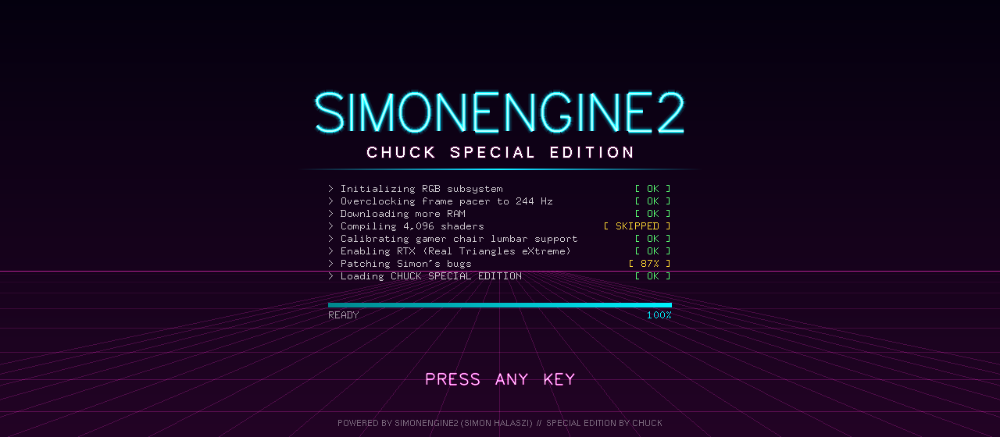

# SimonEngine2 &nbsp;//&nbsp; CHUCK SPECIAL EDITION

**SimonEngine2, but better.** &nbsp;A C++ / OpenGL engine that went to the gamer store and maxed out the credit card.

[](https://github.com/MrChampion01/SimonEngine2/actions/workflows/build.yml)


<br/>


-00f2ff?style=for-the-badge&labelColor=14001f)


<i>"SimonEngine but 3D!!!!!!!"</i> &nbsp;— the original README, in its entirety

</div>

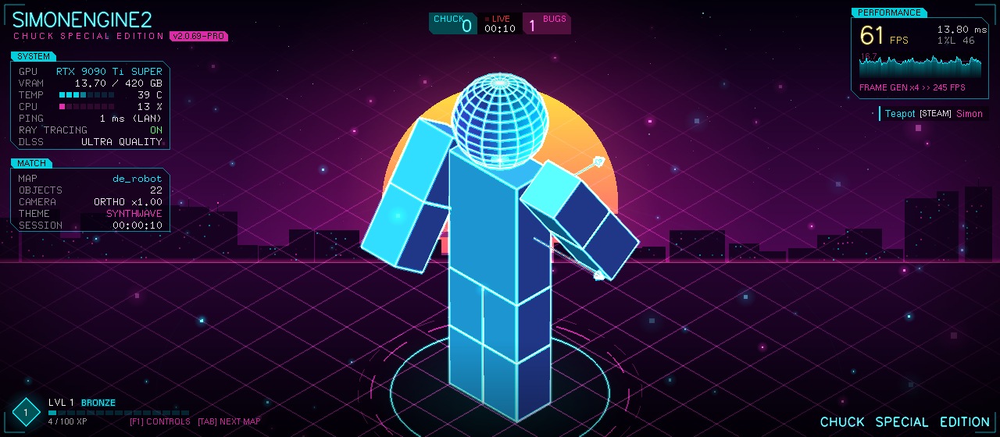

---

## Table of contents

- [What is this](#-what-is-this)
- [Feature tour](#-feature-tour)
- [CHUCK WORLD: the playable demo](#-chuck-world-the-playable-demo)
- [Controls](#-controls)
- [Real vs. smoke and mirrors](#-real-vs-smoke-and-mirrors)
- [Achievements](#-achievements)
- [Building](#-building)
- [How it plugs into the engine](#-how-it-plugs-into-the-engine)
- [Project layout](#-project-layout)
- [Actual engine fixes](#-actual-engine-fixes)
- [Easter eggs](#-easter-eggs)
- [Credits](#-credits)

---

## 🎮 What is this

[SimonEngine2](https://github.com/MrChampion01/SimonEngine2) is Simon's hand-rolled 3D engine for his graphics homework:
freeglut, fixed-function OpenGL, a scene/object hierarchy with quaternion transforms, a mesh registry
with an `.obj` loader, and a robot made of rectangles.

This fork is the **Chuck Special Edition**. It keeps every bit of the homework working exactly as
before (same scenes, same keys) and bolts on an entire layer of gamer energy:

- 🌅 a synthwave sunset backdrop, a neon Tron floor and glowing edge outlines
- 💡 a three-point studio light rig, branded "RAY TRACING" for legal reasons
- 📊 an esports HUD with a **real** FPS graph and **extremely real** GPU telemetry
- 🏆 18 achievements, XP, ranks, a killfeed, and a live CHUCK vs BUGS scoreboard
- 🕹️ **CHUCK WORLD**, a whole playable third-person collect-a-thon built on the engine
- 🎬 cinematic mode, CRT mode, photo mode, screenshots, and a Konami code

All of it is C++14 + OpenGL 1.1. **Zero shaders.** Every "post effect" is a translucent rectangle
wearing a trench coat.

---

## ✨ Feature tour

<table>
<tr>
<td width="50%">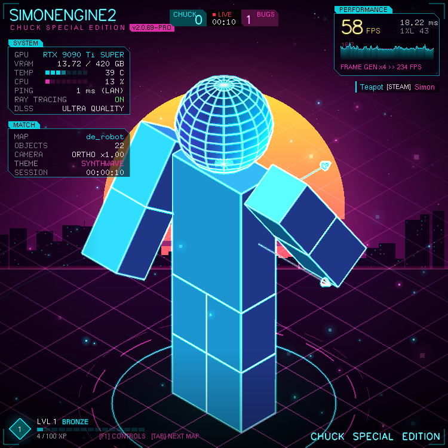</td>
<td width="50%">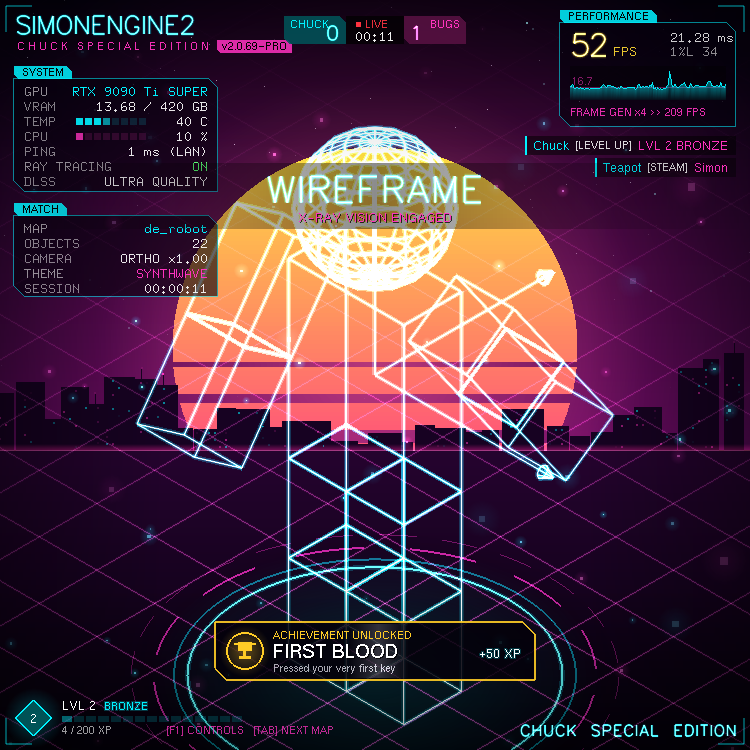</td>
</tr>
<tr>
<td><b>RAY TRACING ON.</b> Shaded robot, cyan/magenta rim lights, Tron floor, spawn pad, HUD, killfeed, scoreboard.</td>
<td><b>Wireframe = hologram.</b> Simon's key <code>1</code>, now with neon glow and an achievement.</td>
</tr>
<tr>
<td>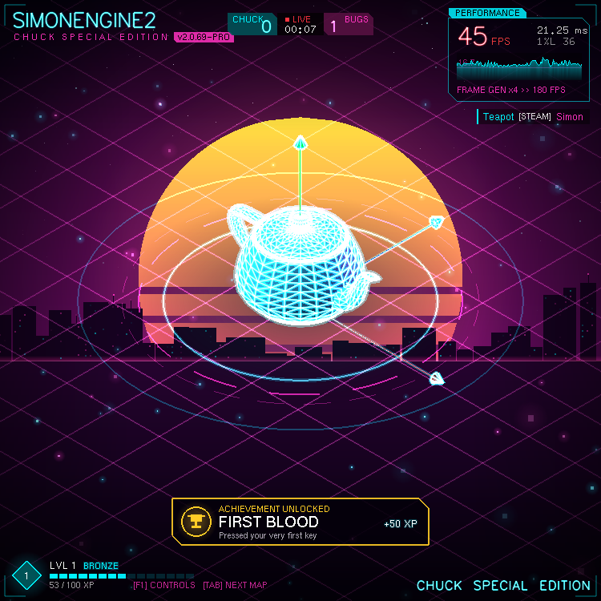</td>
<td>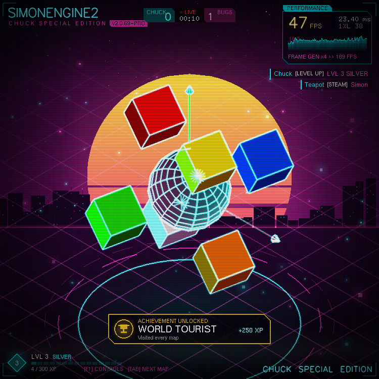</td>
</tr>
<tr>
<td><b>de_teapot.</b> The .obj loader now builds smooth vertex normals, so the teapot can be lit (or turned into a hologram).</td>
<td><b>de_magiccube + F8 CRT.</b> Scanlines, aperture grille, rolling band, glitch tears. 1998 called.</td>
</tr>
<tr>
<td>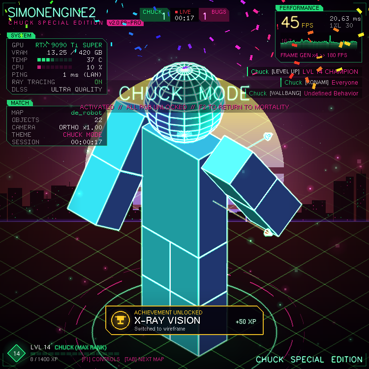</td>
<td>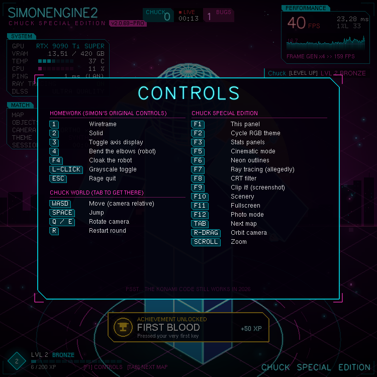</td>
</tr>
<tr>
<td><b>CHUCK MODE.</b> You know the code. Rainbow everything, confetti storm, instant 9001 XP.</td>
<td><b>F1.</b> Every control on one glowing sheet.</td>
</tr>
</table>

### 🌈 Six RGB themes (F2), crossfaded live

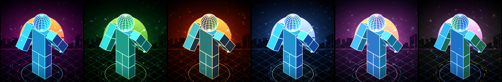

`SYNTHWAVE` · `VENOM` · `INFERNO` · `SUBZERO` · `VAPORWAVE` · `RGB OVERDRIVE` &nbsp;(+ one secret theme)

Every effect pulls its colors from the active theme: sky, sun, floor grid, rim lights, outlines, HUD,
killfeed. Switching melts the whole engine from one palette into the next over 0.6 seconds.

---

## 🕹️ CHUCK WORLD: the playable demo

<div align="center">
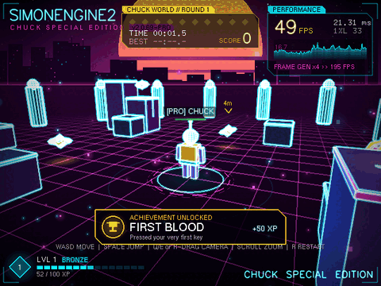
</div>

Press **TAB** from any map until you land on `de_chuckworld`. Then:

| | |
|---|---|
| 🤖 **ChuckBot** | A gold-armored hero built from the engine's own prisms, spheres and cylinders. Legs and arms hang off invisible joint objects, so they actually swing from the hips and shoulders: walk cycle, idle breathing, jump tuck, celebration. |
| 🏃 **Movement** | Camera-relative WASD, gravity, jumping, step-up, and platforming onto crates and towers. |
| 🧱 **Collision** | Circle-vs-box for crates, circle-vs-circle for pillars, plus the arena wall. |
| 🎥 **Camera** | Third-person follow cam with lag, Q/E or right-drag to orbit, scroll to zoom, and camera collision so the lens never clips into a pillar. |
| 💎 **Power cores** | 10 per round, shuffled from 19 spawn spots. Some sit on towers and need a parkour route. Grab them within 3 seconds of each other for a **COMBO** multiplier. |
| 🏁 **Rounds** | Timer, best time, score, speed bonus, nametag, floating `+100`s, a waypoint to the nearest core, and... |

<div align="center">
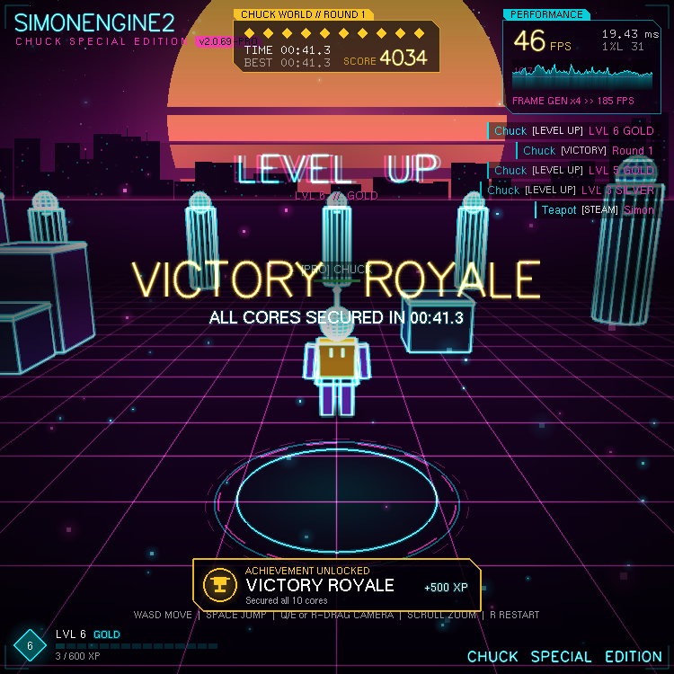
</div>

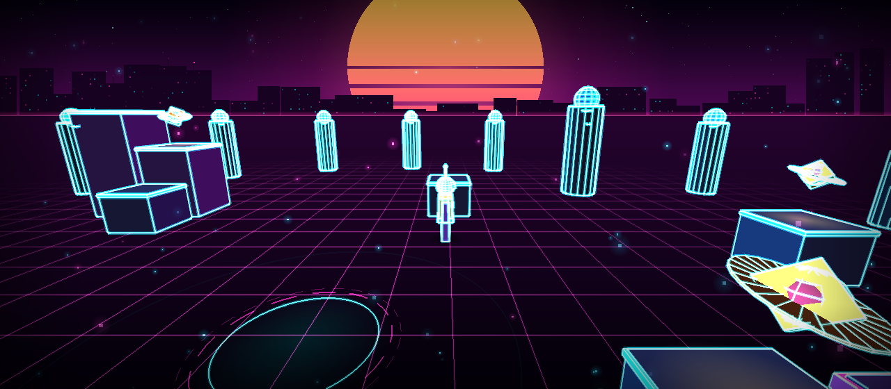

---

## ⌨️ Controls

<table>
<tr><th>Homework (Simon's originals, untouched)</th><th>Chuck Edition</th></tr>
<tr valign="top"><td>

| Key | Does |
|---|---|
| `1` | Wireframe |
| `2` | Solid |
| `3` | Toggle axis display |
| `4` | Bend the robot's elbows |
| `F4` | Hide / show the robot |
| `Left click` | Grayscale toggle |
| `ESC` | Rage quit |

**Chuck World**

| Key | Does |
|---|---|
| `W A S D` / arrows | Move |
| `Space` | Jump |
| `Q` / `E` | Rotate camera |
| `R` | Restart round |

</td><td>

| Key | Does |
|---|---|
| `F1` | Controls sheet |
| `F2` | Cycle RGB theme |
| `F3` | Stats panels |
| `F5` | Cinematic mode (turntable + letterbox) |
| `F6` | Neon outlines |
| `F7` | Ray tracing (allegedly) |
| `F8` | CRT filter |
| `F9` | Clip it! (saves `SE2_CHUCK_CLIP_0001.bmp`) |
| `F10` | Scenery (sky, sun, floor, embers) |
| `F11` | Fullscreen |
| `F12` | Photo mode (hide every overlay) |
| `TAB` | Next map |
| `Right-drag` | Orbit camera |
| `Scroll` | Zoom |

</td></tr>
</table>

Maps rotate `de_robot` → `de_chuckworld` → `de_teapot` → `de_magiccube` with a neon loading wipe.

---

## 🎭 Real vs. smoke and mirrors

The HUD is very convincing. Here is the honest breakdown, for Simon's sake.

| On screen | Reality |
|---|---|
| FPS, frame time, 1% low, frame-time graph | ✅ **Real.** Measured every frame with `std::chrono::steady_clock`. |
| Object count, map, camera mode + zoom, session timer | ✅ **Real.** Read straight from the engine. |
| Neon outlines, lighting, floor, shadows | ✅ **Real** rendering, just very old-school (see below). |
| `RAY TRACING: ON` | 🟡 Three fixed-function directional lights, Gouraud shaded. It *is* lighting. It is not rays. |
| `FRAME GEN x4 >> 976 FPS` | ❌ The real FPS multiplied by four. |
| `RTX 9090 Ti SUPER`, `420 GB VRAM`, GPU temp, CPU load | ❌ Sine waves. |
| `PING 1 ms (LAN)`, `DLSS ULTRA QUALITY` | ❌ Vibes. |
| The killfeed | ❌ Mostly fabricated. `Chuck [WALLBANG] Undefined Behavior` did not happen. Level ups, combos and wins in it are real. |
| Boot screen "Compiling 4,096 shaders" | ❌ There are zero shaders. It says `SKIPPED` because it's honest like that. |

<details>
<summary><b>How do you do neon outlines with zero shaders?</b></summary>
<br/>

Every primitive calls `glColor3f(itsColor)` before drawing, and every one of them disables
`GL_TEXTURE_2D` first. None of them know `GL_TEXTURE_1D` exists. So the outline pass:

1. uploads a **one-texel** 1D texture holding the neon color,
2. enables `GL_TEXTURE_1D` (which nothing ever turns off),
3. sets the texture environment to `GL_REPLACE`, so the texture color wins over the vertex color,
4. redraws the whole scene with `glPolygonMode(GL_LINE)`, polygon offset, and additive blending,
   once fat and faint (glow), once thin and bright (core).

No texture coordinates are sent, so every vertex samples texel 0. The entire scene renders in neon
without touching a single line of the primitive classes. See [`NeonWorld.cpp`](SimonEngine2/NeonWorld.cpp).
</details>

<details>
<summary><b>How does text slide in from off-screen with bitmap fonts?</b></summary>
<br/>

`glRasterPos` outside the viewport marks the raster position invalid and the whole string vanishes.
Render2D puts the raster position at the nearest on-screen point, then nudges it to the real spot
with an empty `glBitmap()` call, whose move offsets aren't validated. Glyphs then clip pixel by pixel
like you'd expect. See [`Render2D.cpp`](SimonEngine2/Render2D.cpp).
</details>

---

## 🏆 Achievements

| | Achievement | How | XP |
|---|---|---|---|
| 🩸 | FIRST BLOOD | Press any key | 50 |
| 👓 | X-RAY VISION | Wireframe mode | 50 |
| 🎞️ | FILM NOIR | Go grayscale | 50 |
| 🫥 | NOW YOU SEE ME | Hide the robot (F4) | 75 |
| 💪 | ELBOW GREASE | Bend an elbow | 100 |
| 🍜 | NOODLE ARMS | Bend the elbows 18 times | 250 |
| 🌈 | TASTE THE RAINBOW | Try every theme | 200 |
| 🎮 | CONSOLE PEASANT | Turn ray tracing off | 25 |
| 🗺️ | WORLD TOURIST | Visit every map | 250 |
| 💎 | POWER UP | Grab a power core | 100 |
| 🔥 | COMBO KING | Chain a x5 combo | 300 |
| 👑 | VICTORY ROYALE | Collect all 10 cores | 500 |
| ⏱️ | SPEEDRUNNER | Win a round in under 45s | 750 |
| 🧗 | PARKOUR! | Stand on the boss tower | 400 |
| 🎬 | DIRECTOR'S CUT | Cinematic mode | 100 |
| 📸 | CLIP IT! | Take a screenshot | 100 |
| 🌱 | TOUCH GRASS | Play for 5 minutes | 300 |
| ❓ | ??? | ??? | 9001 |

XP also trickles in at +1 every 2 seconds, for existing. Ranks go
`BRONZE → SILVER → GOLD → PLATINUM → DIAMOND → CHAMPION → GRAND CHAMPION`.

---

## 🔧 Building

### Windows: Visual Studio (the original way)

1. Open `SimonEngine2.sln` in Visual Studio 2022.
2. Pick **x64** (Debug or Release). freeglut is bundled and statically linked, nothing to install.
3. Press **F5**. The working directory must be the inner `SimonEngine2/` folder so `../Assets/teapot.obj` resolves (that's the VS default).

### Linux (and anything with freeglut): CMake

```bash
# Debian / Ubuntu
sudo apt install build-essential cmake freeglut3-dev libglu1-mesa-dev

cmake -S . -B build -DCMAKE_BUILD_TYPE=Release
cmake --build build -j

cd SimonEngine2 && ../build/SimonEngine2   # run from here so ../Assets resolves
```

### VS Code

Open the folder, accept the recommended extensions, then **Run Build Task** (`Ctrl+Shift+B`) and
**F5**. The launch config already runs from the right folder.

### CI

Every push builds on **Linux** (CMake) and **Windows** (the real `.sln` with MSBuild). The Linux job
also boots the engine headless under Xvfb for 8 seconds and uploads a screenshot as an artifact, so
you can see each commit's drip from the Actions tab.

---

## 🧩 How it plugs into the engine

Chuck Edition lives in a singleton (`ChuckEdition`) attached to the engine through a handful of
one-line hooks. The homework code (scenes, objects, input bindings) didn't have to change.

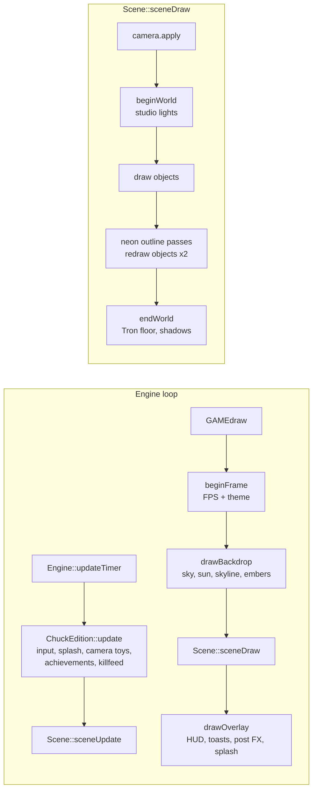

| Module | Job |
|---|---|
| `ChuckEdition` | Mission control: hooks, toggles, timing, XP, map rotation, secrets |
| `GamerTheme` | Palettes, HSV rainbow, crossfades |
| `Render2D` | Pixel-space 2D toolkit: gradients, chamfered panels, glow + neon stroke text |
| `StudioLighting` | The "ray tracing" (three camera-space directional lights) |
| `Backdrop` | Sky, synthwave sun, procedural skyline, stars, embers |
| `NeonWorld` | Tron floor, spawn pad, contact shadow, neon outline passes |
| `Hud` | Performance, telemetry, scoreboard, XP bar, controls sheet, confetti |
| `Notifications` | Achievements, callouts, killfeed |
| `SplashScreen` | Boot screen with the fake boot log |
| `PostFX` | Vignette, letterbox, CRT, flash |
| `Screenshot` | Hand-rolled 24-bit BMP writer |
| `ChuckWorldScene`, `ChuckBot`, `PowerCore` | The playable demo |

---

## 📁 Project layout

```
SimonEngine2/
├── Assets/                    teapot.obj, teddy.obj, airboat.obj
├── docs/media/                README screenshots + gameplay GIF
├── SimonEngine2/
│   ├── Engine, Scene, Object, Camera, InputManager, MeshRegistry   ← Simon's engine core
│   ├── Primitive, RectangularPrism, Sphere, Cone, Cylinder, Line   ← Simon's primitives
│   ├── Robot, Limb, MagicCube, AxisDisplay, ObjMesh                ← Simon's objects
│   ├── RobotScene, ObjScene, MagicCubeScene                        ← Simon's homework scenes
│   ├── ChuckEdition, GamerTheme, Render2D, StudioLighting, ...     ← the special edition
│   ├── ChuckWorldScene, ChuckBot, PowerCore                        ← the game
│   ├── include/, lib/                                              ← bundled freeglut + glad
│   └── SimonEngine2.vcxproj                                        ← VS project (everything registered)
├── CMakeLists.txt             cross-platform build
├── .github/workflows/         CI (Linux + Windows + headless smoke test)
└── .vscode/                   build/run configs + recommended extensions
```

---

## 🛠️ Actual engine fixes

Not everything here is RGB. While in there, a few real bugs got squashed:

- **F4 was secretly F1.** `isSpecialKeyPressed()` indexed its state with the raw GLUT code while the
  callbacks stored the *remapped* slot, so `GLUT_KEY_F4` (4) read F1's slot. Queries now remap too.
- **No more dropped taps.** A key pressed and released between two update ticks used to vanish.
  InputManager now latches presses/releases, and key auto-repeat no longer re-fires presses.
- **Robot::setColor skipped the limbs** after the Homework 2 refactor turned them into `Limb`s.
- **Surface normals everywhere.** Nothing emitted `glNormal`, so lighting was impossible. Every
  primitive now has proper normals, and `.obj` meshes get smooth, area-weighted vertex normals.
- **CMake + CI**, so the engine builds and boots on more than one machine.

---

## 🥚 Easter eggs

<details>
<summary><b>Spoilers. Obviously.</b></summary>
<br/>

- **↑ ↑ ↓ ↓ ← → ← → B A** → CHUCK MODE: secret gold/purple rainbow theme, confetti storm, 9001 XP,
  rank `CHUCK (MAX RANK)`. F2 returns you to mortality.
- Type **`simon`** anywhere → `SIMON DETECTED // SKILL ISSUE INCOMING` (+1 to Chuck on the scoreboard)
- Type **`chuck`** → `THE GOAT HAS ENTERED THE CHAT`
- Type **`rtx`**, **`fps`**, **`lag`**, **`gg`** → assorted gamer cope
- The splash screen's progress bar stalls at 99%. On purpose. Like every installer ever.
- The SIMONENGINE2 logo in the HUD flickers like a dying neon tube every ~7 seconds.

</details>

---

## 🙏 Credits

- **Simon Halaszi**: the original SimonEngine2 and every line of the homework it was built for.
  The scene graph, quaternion math, mesh registry and `.obj` loader are all his.
- **Chuck**: the Special Edition. The drip. The audacity.
- [freeglut](https://freeglut.sourceforge.net/) and [glad](https://github.com/Dav1dde/glad), bundled under their own licenses.

See [`CHANGELOG.md`](CHANGELOG.md) for the full patch notes.

<div align="center">
<br/>
<b>GG WP.</b>
</div>
